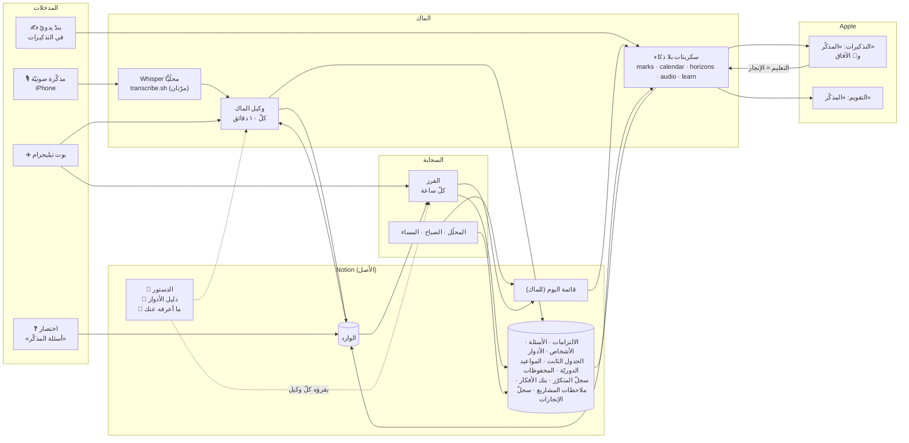

# المذكّر الذكي (Smart Mudhakkir)

**نظام تذكيرٍ شخصيّ لصاحب الأدوار المتعدّدة: تتكلّم، فيتذكّر عنك.**

تقول لهاتفك «ذكّرني أن أردّ على فلان بعد الاجتماع، ولا تنسَ موعد التحاليل الخميس»، ثمّ تمضي. يفرّغ الماك كلامك محلّيًّا، ويفرزه وكلاء Claude إلى التزاماتٍ في Notion بأدوارها وأسبابها وأوقاتها، ثمّ يظهر يومك في «التذكيرات» و«التقويم» على iPhone مرتّبًا بين الصلوات. تعلّم البند فيصير منجزًا. وما نقص يسألك عنه النظام بأقلّ ما يمكن، ويتعلّم من أجوبتك وتصحيحاتك.

> الغاية: أن يحمل النظام عنك التذكّر، فينشغل ذهنك بالتحليل والإنجاز لا بحراسة ما تخشى نسيانه، من غير أن يصير النظام نفسه عبئًا عليك.

## الفكرة

من له أدوارٌ كثيرة (عملٌ وتدريسٌ وأسرةٌ ووالدان وعلمٌ ومشاريع) لا ينقصه تطبيق مهامّ، بل ينقصه **من يكتب عنه**. فالتطبيقات تطلب منك أن تصنّف وتؤرّخ وترتّب، وهذا عبءٌ يُترك بعد أسبوع. أمّا «المذكّر» فمبنيٌّ على أنّ:

- **الوكيل يكتب، وصاحب النظام ينظر.** لا تصنّف ولا ترتّب؛ تتكلّم وتعلّم ما أنجزت.
- **كلّ التزامٍ معه سببه.** التذكير يقول لماذا، لا ماذا فقط.
- **لكلّ حقيقةٍ أصلٌ واحد** (Notion)، وما في تطبيقات Apple نسخٌ للعرض.
- **دستورٌ مكتوب** يقرؤه كلّ وكيلٍ قبل أن يعمل، فلا تتغيّر القواعد بتغيّر الوكيل أو النموذج.
- **المعاني ثابتة، والقنوات تتغيّر**: الإدخال والعرض طبقاتٌ تُركَّب وتُنزع، والالتزام (لمن، وماذا، ومتى، ولماذا) باقٍ.

## الطبقات

```
المدخلات  ←  الوارد  ←  الوكلاء  ←  Notion  ←  Apple
(صوت، تيليجرام،   (ما قيل    (فرزٌ بحسب   (الأصل:      (التذكيرات، التقويم،
 أجوبة، يدويّ)    كما قيل)   الدستور)     ١٢ مخزنًا)    الآفاق، الويدجات)
```



| الطبقة | الشرح |
|---|---|
| المدخلات | [docs/01-input.md](docs/01-input.md) |
| الوارد | [docs/02-inbox.md](docs/02-inbox.md) |
| الوكلاء والسكربتات | [docs/03-agents.md](docs/03-agents.md) |
| Notion | [docs/04-notion.md](docs/04-notion.md) |
| العرض في Apple | [docs/05-apple.md](docs/05-apple.md) |
| الدروس | [docs/lessons.md](docs/lessons.md) |

## ما يميّزه

- **مزامنةٌ تدريجيّة لا تكرّر الإشعارات**: ما لم يتغيّر في «التذكيرات» لا يُمسّ، والموقوت لا يرنّ في منتصف الليل.
- **تفريغٌ محلّيٌّ مرّتين**: بمسرد الأسماء، وبلا مسرد للكلمات الأجنبيّة التي يُسقطها المسرد؛ والصوت لا يخرج من الماك للتفريغ.
- **أسئلةٌ قليلة**: الصفات تُفترض ويُصرَّح بالافتراض، والمضمون الغامض لا يُفترض أبدًا بل يُسأل عنه؛ وخمسة أسئلةٍ في اليوم على الأكثر، وسؤالٌ واحد لكلّ بند.
- **الأسئلة تأتيك**: بندٌ واحد «أسئلة اليوم» ينبّهك بعد الصلاة التالية، واختصارٌ يعرضها بخياراتها وتجيب بنقرة أو بصوتك.
- **يتعلّمك**: تصحيحاتك («أخطأت…»، «من الآن…») قواعد تُكتب في «ما أعرفه عنك»، وأوقات إنجازك الفعليّة تُرصد كلّ أسبوع.
- **آفاقٌ في الويدجت**: الأسبوع والشهر والربع والنصف والسنة، والتعليم فيها يصل إلى الأصل.
- **صوتك الأصليّ مع التذكير**: «🎧 اسمع كلامك» حين لا يكفي النصّ، ثمّ يُحذف تلقائيًّا إذا تمّ الأمر.
- **ما لا يحتاج ذكاءً يجري بسكربتات**: العلامات والتقويم والآفاق تعمل ولو تعطّل الموصل.
- **أوقات الصلاة مراسي اليوم**: تُحسب لمدينتك بلا شبكة، وتُقترح الأوقات بالنسبة إليها.

وتفصيل المشكلات التي صنعت هذه الحلول في [docs/lessons.md](docs/lessons.md).

## المتطلّبات

- **ماك** بمعالج Apple، وعليه Homebrew وPython 3 (يعمل حين يكون مفتوحًا؛ والسحابة تكمل الفرز والرسائل وهو مغلق).
- **iPhone** بتطبيقات «الاختصارات» و«المذكّرات الصوتيّة» و«التذكيرات» و«التقويم»، ونفس Apple ID مع iCloud Drive.
- **Notion**: مساحةٌ وتكاملٌ داخليّ (مفتاحه في سلسلة مفاتيح الماك)، وموصل Notion في Claude.
- **اشتراك Claude** يتيح المهامّ المجدولة السحابيّة وClaude Code على الماك.
- **whisper.cpp وffmpeg** (`brew install whisper-cpp ffmpeg`) ونموذج Whisper (يُقترح large-v3، نحو ٣ جيجابايت).
- اختياريّ: **تيليجرام** وبوتٌ خاصّ بك.

## التثبيت

المستودع مهارةٌ لـ Claude Code: [`SKILL.md`](SKILL.md) يقود Claude ليثبّت النظام معك خطوةً خطوة: يسألك عن أدوارك وأشخاصك ومدينتك ولغتك، وينشئ مخازن Notion بخصائصها، ويكتب دستورك من القالب، ويثبّت Whisper، ويبني الاختصارين، وينشئ المهامّ المجدولة. والمفاتيح وكلمات المرور تدخلها أنت بنفسك.

```
smart-mudhakkir/
├── README.md
├── LICENSE
├── SKILL.md                         مهارة التثبيت
├── constitution/
│   ├── constitution.template.md     الدستور مجرَّدًا
│   └── roles.template.md            دليل الأدوار بأدوارٍ أمثلة
├── agents/                          تعليمات الوكلاء المجدولين (قوالب)
│   ├── triage.md  mac-round.md  morning.md  evening.md  analyst.md
├── mac/                             سكربتات الماك
│   ├── config.example.json  config.py
│   ├── transcribe.sh  telegram_pull.py  telegram_ack.py  stuck_transcripts.py
│   ├── mac_marks.py  mac_calendar.py  mac_horizons.py  mac_audio.py  mac_learn.py  mac_projects.py
│   ├── reminders.js  calendar.js  horizons.js  prayer_times.py
│   ├── build_questions.py  build_voice.py
│   ├── glossary.example.txt
│   └── check_private.py             فاحص الخصوصيّة قبل النشر
├── shortcuts/README.md              بناء الاختصارين
└── docs/                            شرح الطبقات والدروس
```

كلّ معرّفٍ ومسارٍ واسمٍ خاصّ في `mac/config.json` (لا يُرفع)، ويُقرأ عبر `mac/config.py`. وقبل أن تنشر نسختك: `python3 -I mac/check_private.py` (يقرأ كلماتك المحظورة من `mac/private_words.txt`، ولا يُرفع هو أيضًا).

## الترخيص

[MIT](LICENSE) © 2026 المذكّر الذكي contributors.

---

## English summary

**Smart Mudhakkir** ("the smart reminder") is a personal reminder system for people who juggle many roles. You *speak* — an iPhone voice memo (Action Button → Voice Memos) or a private Telegram bot — and the system does the remembering:

1. **Input → Inbox.** Recordings sync to the Mac via iCloud and are transcribed **locally** with whisper.cpp (twice: once with a name glossary for proper nouns, once without it to keep foreign words the glossary suppresses). Everything lands, as said, in a Notion "Inbox" database.
2. **Agents.** Scheduled Claude agents — an hourly cloud triage, a 10‑minute Mac round, a daily analyst, and morning/evening digests — read a written **constitution** and a **roles guide** before acting, then sort the inbox into Notion databases: commitments (each with *why*), questions, people, roles, fixed weekly schedule, periodic dates, memorization (spaced repetition), recurring log, idea bank, project notes and achievements.
3. **Display.** AI‑free Mac scripts (Python + JXA) render the day into Apple **Reminders** and **Calendar** and their widgets, ordered around the five daily prayers, plus five "horizon" lists (week → year). Checking an item off marks it done in Notion. Sync is incremental, so alarms never re‑fire.
4. **Questions & learning.** Missing details that are cheap to get wrong (role, rough time) are assumed and labelled as assumptions; vague *content* is never assumed — it becomes a question. At most five new questions a day, one per item, answered through a generated Shortcut. Corrections and answers become rules in a "What I know about you" page, and actual completion times are measured weekly.

Requirements: an Apple‑silicon Mac, an iPhone, Notion (internal integration key stored in the macOS Keychain), a Claude plan with scheduled tasks and Claude Code, whisper.cpp and ffmpeg; Telegram is optional. Installation is driven by [`SKILL.md`](SKILL.md), a Claude Code skill that interviews you, creates the Notion databases, writes your constitution from the template, installs Whisper, builds the Shortcuts and schedules the agents. All IDs and personal settings live in an untracked `mac/config.json`; `mac/check_private.py` scans the repo for Notion IDs, emails, phone numbers, home paths and your own banned words before you publish. Licensed under MIT.
